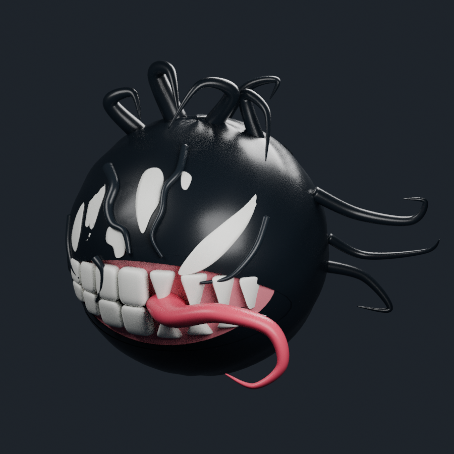
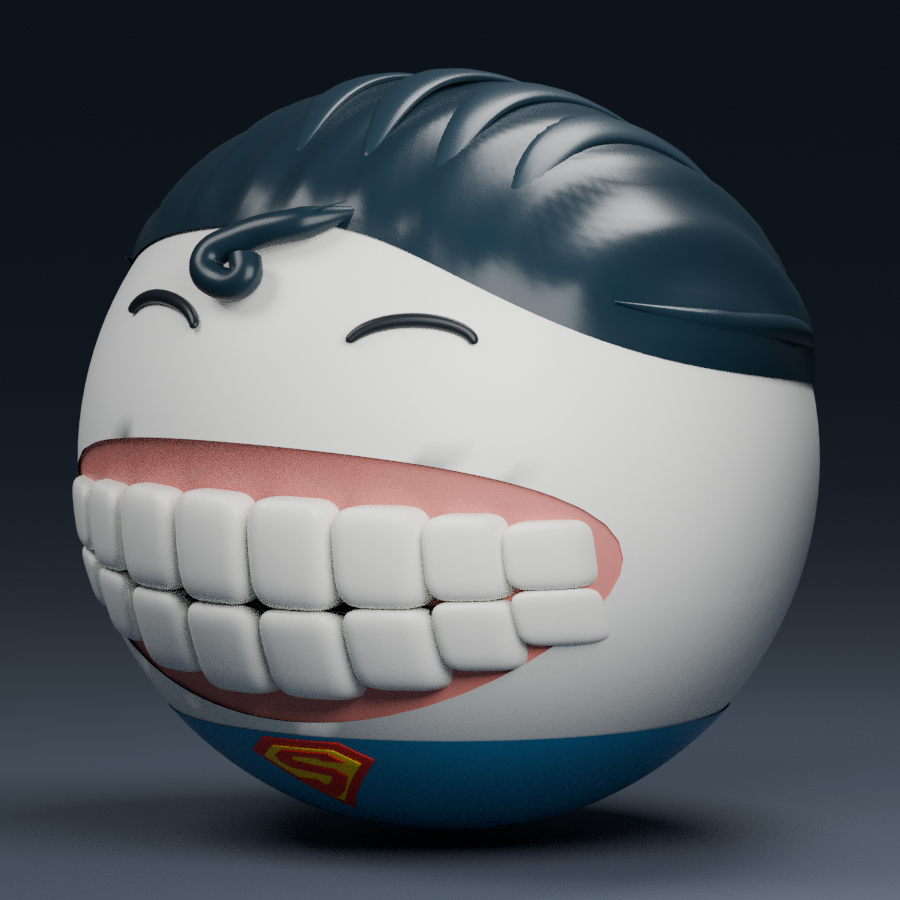
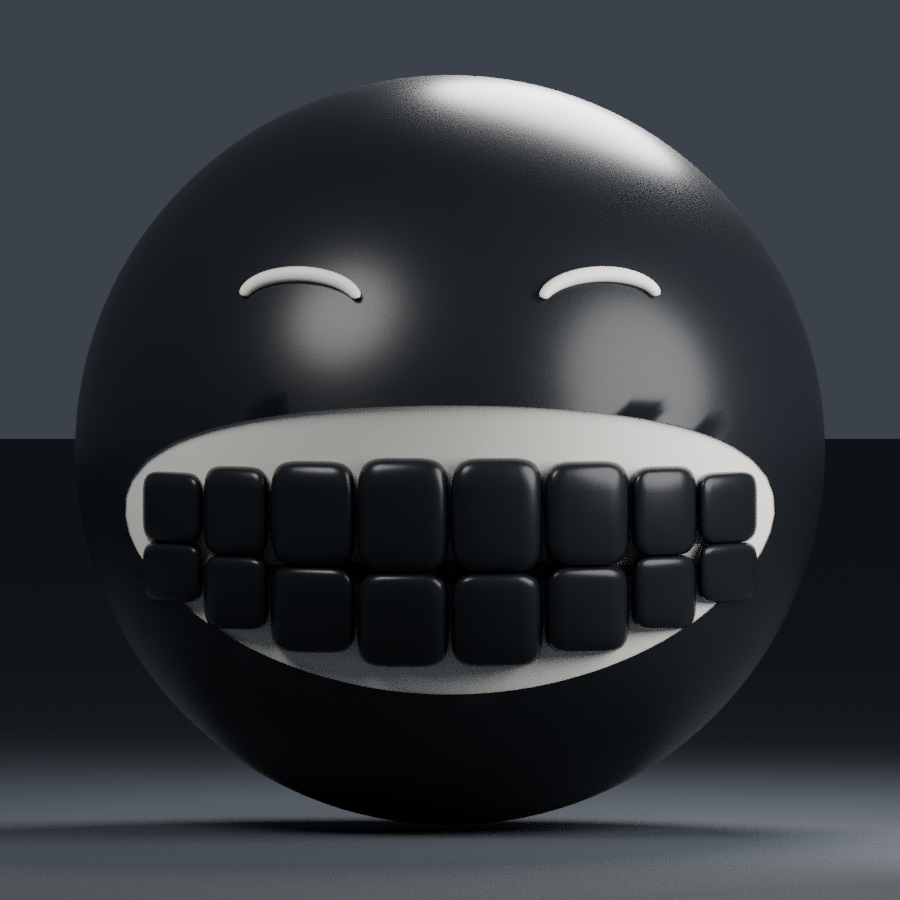

# 7 Deadly Crax — SymbiotiCrax

**[Télécharger SymbiotiCrax-TOTAL.zip](dist/SymbiotiCrax-TOTAL.zip)** · [Installation Studio](docs/symbioticrax/INSTALLATION.md) · [État réel](docs/symbioticrax/ETAT.md)

SymbiotiCrax : vraie tête CraxSourire transformée, asymétrie noire/blanche, crocs, langue recourbée et neuf tentacules. Langue prédatrice, contamination, armure vivante, parasite, scène MAX et trophée doré ; prix repris du barème Épique GhostyCrax confirmé.



[Face](assets/symbioticrax/model/face.png) · [Profils](assets/symbioticrax/model/profil-droit.png) · [Dos interprété](assets/symbioticrax/model/dos.png) · [Comparaison avec la vraie base](assets/symbioticrax/model/comparaison-base-symbioti.png) · [Bouche ouverte](assets/symbioticrax/model/bouche-ouverte.png) · [Choix de réalisation](docs/symbioticrax/DECISIONS.md)

Le ZIP contient modèles modifiables/importables, rendus, illustrations, 21 sons originaux individuels et **un seul atlas WAV de 13,47 s à importer**, sources, VFX, tests et installateur réversible. [Écouter les WAV avant import](assets/symbioticrax/audio/ECOUTER.html).

**Import et tests Studio encore nécessaires.** Aucune place ou ressource Roblox n’a été publiée depuis cet environnement. Après import des accessoires, [la commande complète](integration/symbioticrax/INSTALLER_SYMBIOTICRAX.lua) s’exécute en STOP dans la place existante avec SuperCrax déjà installé. Elle lit le contenu de l’éditeur et refuse les conflits, sans restaurer d’anciennes versions. Les tests réels du moteur sont distingués des [tests locaux exécutés](docs/symbioticrax/TESTS.md).

---

# 7 Deadly Crax — SuperCrax et InvertedCrax

**[Télécharger SuperCrax-TOTAL.zip](dist/SuperCrax-TOTAL.zip)** · [Installation Studio](docs/supercrax/INSTALLATION.md) · [État réel et imports restants](docs/supercrax/ETAT.md)

SuperCrax : tête seule dérivée du vrai CraxSourire, chevelure sculptée avec boucle, écusson rouge/jaune, trois pouvoirs cumulatifs et exécution MAX. Sources Blender/FBX/OBJ, quatre illustrations du livre, 19 WAV originaux, VFX, intégration aux systèmes existants, installateur réversible et tests inclus.



[Face](assets/supercrax/model/face.png) · [Profil](assets/supercrax/model/profil.png) · [Dos](assets/supercrax/model/dos.png) · [Comparaison avec la vraie base](assets/supercrax/model/comparaison-base-super.png) · [Choix confirmés et provisoires](docs/supercrax/DECISIONS.md) · [Tests exécutés](docs/supercrax/TESTS.md)

**Ce lot nécessite l’import FBX, des sons et des images dans Roblox Studio.** Aucune ressource Roblox fictive, aucune place publiée ou testée ici. Après import des accessoires, la [commande complète](integration/supercrax/INSTALLER_SUPERCRAX.lua) s’exécute en STOP dans la place existante ; elle préserve les sources actuelles et leurs correctifs indépendants. Nouveau Play requis ensuite.

---

# InvertedCrax

Personnage **tête seule**, dérivé du véritable Crax Sourire : vinyle noir, yeux blancs, sourire à dents noires et X blanc derrière la tête.



[Vue de dos](assets/invertedcrax/head-only/dos.png) · [Vue de trois quarts](assets/invertedcrax/head-only/trois-quarts.png)

## Paquet total

**[Télécharger InvertedCrax-TOTAL.zip](dist/InvertedCrax-TOTAL.zip)**

Il contient le modèle Blender/FBX/OBJ, les rendus, les 19 WAV originaux, les sources serveur/client, les adaptations du livre et des catalogues, les animations/VFX, les tests, l’installateur et le retour arrière. Il s’installe dans le projet Roblox existant analysé, pas dans une place vide.

**Play arrêté**, copier tout [`INSTALLER_INVERTEDCRAX.lua`](integration/invertedcrax/INSTALLER_INVERTEDCRAX.lua) dans la barre de commande de Studio, puis exécuter. La commande vérifie vos sources avant de modifier le projet et les sauvegarde. Une réexécution ne crée aucun doublon.

[Instructions complètes et tests Studio](integration/invertedcrax/INSTALLATION.md) · [Retour arrière](integration/invertedcrax/RETOUR_ARRIERE.lua) · [Brancher les sons et l’icône importés](integration/invertedcrax/BRANCHER_AUDIO_ET_ICONE.lua)

## Fonctionnalités dans le code

- Épique, 120 PV, mêlée 8, vitesse et prix repris des réglages existants.
- Collection, livre à quatre niveaux, casino et progression via les systèmes existants.
- MUTE / SILENCE ; PIRATAGE et vulnérabilité ; COPIER-COLLER ; CTRL-Z.
- ERREUR 404 : cinématique de victoire MAX avec copies visuelles, fragments, effet monochrome local et restauration de la caméra.
- Aucun nouveau trophée, don universel du personnage, DataStore parallèle ou identifiant Roblox inventé.

## Validation et limites

Les tests locaux exécutent le Luau et les sources réellement modifiées avec des services simulés. Les fichiers Blender et WAV ont leurs propres contrôles. **Roblox Studio n’a pas été exécuté ici** : réplication réelle, rendu, sauvegarde, achats, permissions audio et non-régression nécessitent les vérifications documentées avant publication.

Les WAV doivent être importés dans Roblox et leurs vrais IDs configurés pour les entendre en jeu. L’icône SILENCE reste facultative ; le statut fonctionne avec un X et un texte sans image.

[État détaillé](ETAT-INTEGRATION.md) · [Tests exécutés](integration/invertedcrax/TESTS.md) · [Audit SILENCE](integration/invertedcrax/silence-audit.json)

## Développement

Node.js 22+ et Python 3 sont nécessaires pour les commandes de préparation et de test :

```sh
npm ci
npm test
npm run build:installer
```

Le générateur reconstruit l’installateur depuis `src/invertedcrax` et l’export inspecté conservé comme fixture. `integration/invertedcrax/patched` fournit les vingt et une sources complètes pour revue. Les scripts de modélisation sont fournis pour traçabilité ; la scène intermédiaire avec corps n’est pas nécessaire à l’installation et n’est pas le personnage livré.
